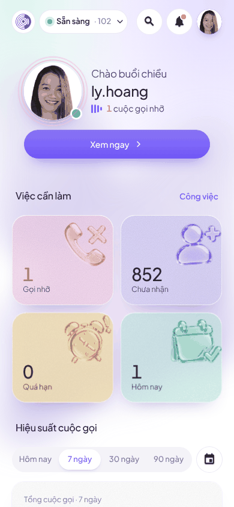
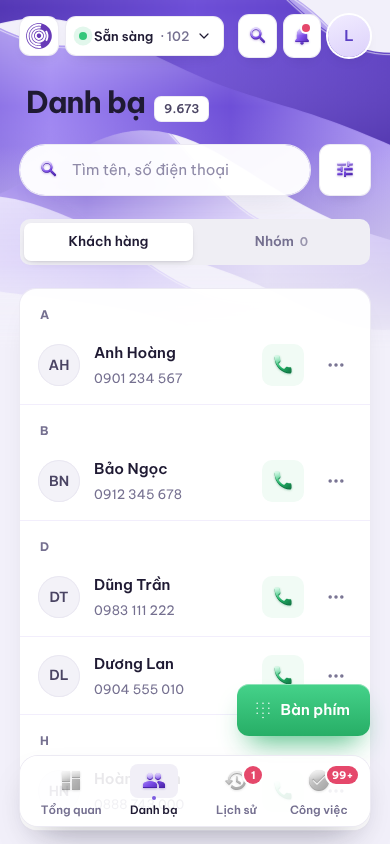
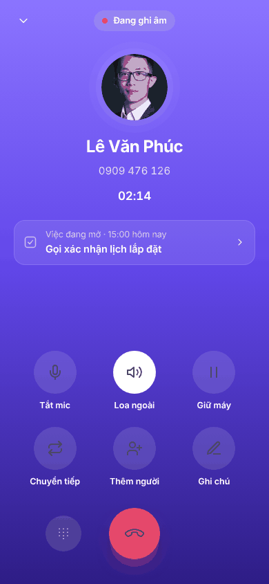
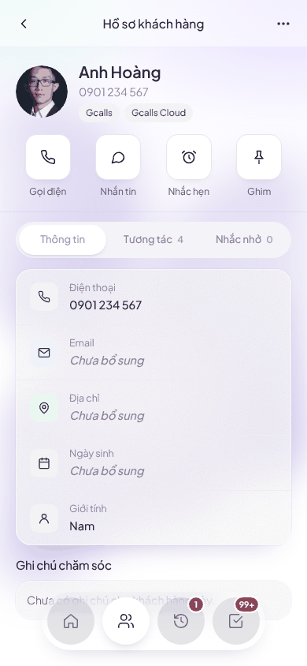

# Gcalls ContactHub · Mobile app (mockup bàn giao)

App mobile cho tổng đài viên Gcalls: **25 màn hình**, giao diện sáng tím – trắng (phong cách "Elle") và giao diện tối dùng chung bố cục. Có prototype bấm được, hiệu ứng chuyển cảnh và đặc tả cho dev.

> Đây là **mockup**, chưa phải app. Dữ liệu trong màn hình là dữ liệu giả.

## Xem nhanh

**Mở file [`index.html`](index.html)** (bấm đúp, không cần server): app nằm trong khung iPhone. Bạn có thể:
- bấm tab và các nút để chuyển màn
- cuộn bên trong máy; thanh tab luôn hiển thị để quay về bất kỳ module nào
- đổi giữa giao diện Sáng và Tối
- chọn nhanh bất kỳ module nào trong menu phía trên

| Tổng quan | Danh bạ | Đang gọi | Hồ sơ khách hàng |
|---|---|---|---|
|  |  |  |  |

Ảnh của cả 25 màn nằm trong [`docs/screens/`](docs/screens). Tên có hậu tố `-toi` là bản tối.

## Các module

| Nhóm | Màn hình |
|---|---|
| 4 tab chính + Tài khoản | Tổng quan · Danh bạ · Lịch sử · Công việc · Tài khoản |
| Trạng thái, tìm kiếm, thông báo, khách hàng | Trạng thái trực · Tìm kiếm · Thông báo · Xem nhanh khách hàng · Hồ sơ khách hàng |
| Bộ lọc, chi tiết cuộc gọi, công việc | Bộ lọc lịch sử · Chi tiết cuộc gọi · Bộ lọc công việc · Diễn biến công việc · Tạo nhắc hẹn |
| Luồng gọi điện | Bàn phím quay số · Đang gọi · Cuộc gọi đến · Kết thúc cuộc gọi · Nhắn tin SMS |
| Đăng nhập & trạng thái hệ thống | Đăng nhập (Keycloak SSO) · Cấp quyền lần đầu · Đang tải · Không có kết quả · Mất kết nối |

## Brand guideline & Figma

- [`design/brand-guidelines.html`](design/brand-guidelines.html): logo, màu, chữ, lưới, icon, thành phần, hiệu ứng, chuyển động, giao diện tối.
- `design/gcalls-tokens.json`: token W3C DTCG, nhập vào Figma Variables hoặc plugin Tokens Studio; dev dùng với Style Dictionary.
- `design/assets/`: logo (tím, trắng, icon app 1024), 24 icon nét SVG, 4 icon kính 3D PNG.
- Sinh lại bằng `python3 tools/build_brand.py`.

## Cấu trúc

```
index.html           File duy nhất, tự chứa: khung iPhone + 25 màn + CSS + ảnh (sinh bởi tools/build_single.py)
tools/
  build_single.py    Đóng gói prototype/ thành index.html. Chạy lại sau mỗi lần sửa prototype/
docs/
  SPEC.md            Đặc tả: điều hướng, danh sách màn, design token, component, quy tắc, dữ liệu, tích hợp
  screens/*.png      Ảnh từng màn (sáng; -toi = tối)
prototype/           Mã nguồn để chỉnh sửa
  index.html         Khung iPhone (bản đọc file rời, cần server tĩnh)
  gallery.html       Thư viện 25 màn (?night=1 để xem bản tối)
  viewer.html        Xem một màn ở cỡ thật (?s=Main, &night=1)
  dc-lite.js         Trình hiển thị file .dc.html + gắn giao diện sáng/tối + hiệu ứng chuyển màn
  canvas.json        Danh sách màn, nhóm, tiêu đề
  screens/*.dc.html  Mã nguồn từng màn (HTML + style inline + logic hiển thị)
  assets/
    contacthub.css   Toàn bộ style và design token
    icons/*.svg      Icon theo tên
    deco/*.png       4 icon kính 3D cho 4 thẻ chỉ số
    people/*.jpg     Ảnh đại diện khách hàng mẫu
    theme/*.svg      Hình nền, icon phụ
```

Muốn sửa giao diện: sửa trong `prototype/`, xem bằng `cd prototype && python3 -m http.server 8000`, rồi chạy `python3 tools/build_single.py` để cập nhật `index.html`.

## Cho dev

1. Đọc [`docs/SPEC.md`](docs/SPEC.md) trước.
2. Lấy kích thước, màu và khoảng cách từ `prototype/screens/*.dc.html` và `prototype/assets/contacthub.css`.
3. `dc-lite.js` chỉ dùng để chạy mockup, không dùng cho production.
4. Các ô `[NGOẶC VUÔNG]` trong màn hình là thông tin cần Gcalls xác nhận (mục 9 của SPEC).
5. Ảnh người trong mockup là ảnh thật do khách hàng cung cấp, chỉ dùng minh hoạ; hỏi ý trước khi công khai repo.
