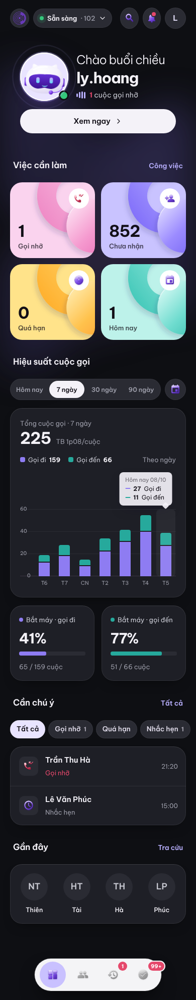
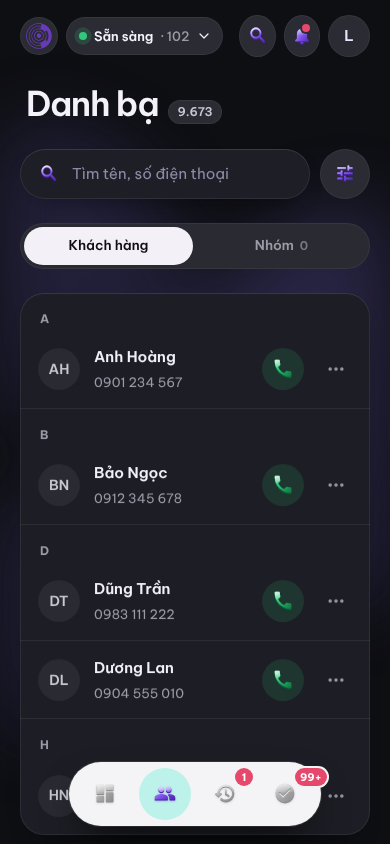
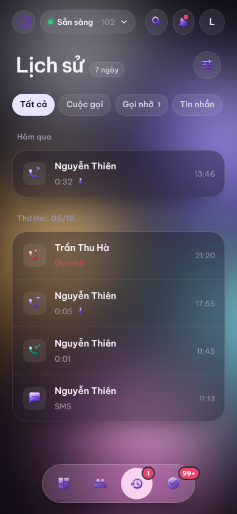
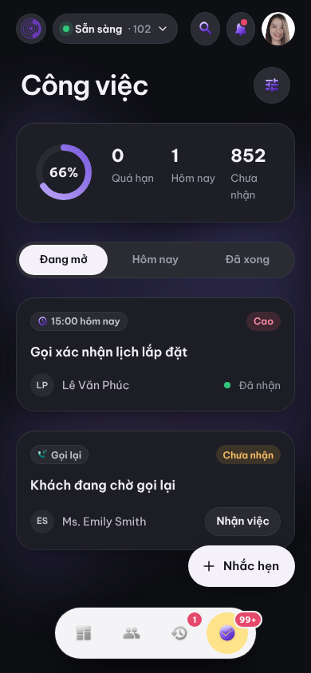

# Gcalls ContactHub · Mobile app (mockup bàn giao)

Bộ thiết kế app mobile cho tổng đài viên Gcalls, **giao diện tối**: 5 màn chính (Tổng quan, Danh bạ, Lịch sử, Công việc, Tài khoản), kèm bản sáng thử nghiệm để so sánh, prototype bấm được và đặc tả cho dev.

> Đây là **mockup**, chưa phải app. Dữ liệu trong màn hình là dữ liệu giả.

## Xem nhanh

| Tổng quan | Danh bạ | Lịch sử | Công việc |
|---|---|---|---|
|  |  |  |  |

Ảnh của tất cả các màn nằm trong [`docs/screens/`](docs/screens).

## Chạy prototype

Cần một web server tĩnh, vì trình duyệt không cho đọc file khi mở trực tiếp bằng `file://`:

```bash
cd prototype
python3 -m http.server 8000      # hoặc: npx serve .
```

Sau đó mở:

- http://localhost:8000/ để xem tất cả màn hình
- http://localhost:8000/viewer.html?s=MainD để mở một màn và bấm thử (thanh tab và avatar chuyển màn)

Cũng có thể bật **GitHub Pages** cho thư mục `prototype/` để chia sẻ link.

## Cấu trúc

```
docs/
  SPEC.md            Đặc tả: điều hướng, danh sách màn, design token, component, quy tắc, mô hình dữ liệu, tích hợp, câu hỏi mở
  screens/*.png      Ảnh từng màn (390 × 844; Tổng quan và Tài khoản dài hơn). Hậu tố D = tối, L = sáng
prototype/
  index.html         Thư viện màn hình
  viewer.html        Xem một màn ở cỡ thật
  dc-lite.js         Trình hiển thị nhỏ cho file .dc.html (chỉ dùng để xem mockup)
  canvas.json        Danh sách màn, tiêu đề, vị trí và ghi chú thiết kế
  screens/*.dc.html  Mã nguồn từng màn: HTML + CSS inline + logic hiển thị
  assets/
    contacthub.css   Toàn bộ style và design token (:root)
    icons/*.svg      Icon theo tên: phone, call-missed, nav-*, …
    theme/*.svg      Hình nền và icon cho bản tối / sáng
```

## Cho dev

1. Đọc [`docs/SPEC.md`](docs/SPEC.md) trước.
2. Lấy kích thước, màu và khoảng cách trực tiếp từ `prototype/screens/*.dc.html` và `assets/contacthub.css`. Style viết inline nên tra từng phần tử rất nhanh.
3. Có thể bỏ qua `dc-lite.js`. Nó chỉ để chạy mockup, không dùng cho production.
4. Các ô `[NGOẶC VUÔNG]` trong màn hình là thông tin cần Gcalls xác nhận (mục 9 của SPEC).

## Nguồn thiết kế

Bản gốc nằm trên canvas thiết kế **ContactHub Redesign** (Claude Design). Khi thiết kế thay đổi, xuất lại các file `.dc.html` vào `prototype/screens/` rồi chụp lại ảnh.
